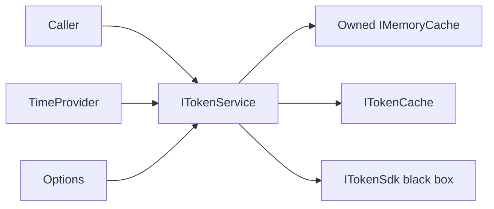
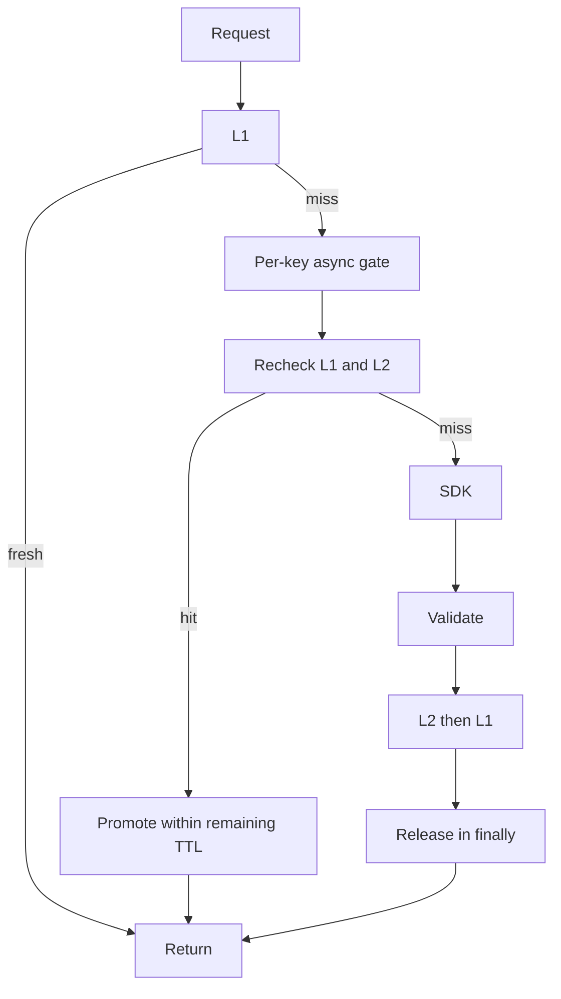
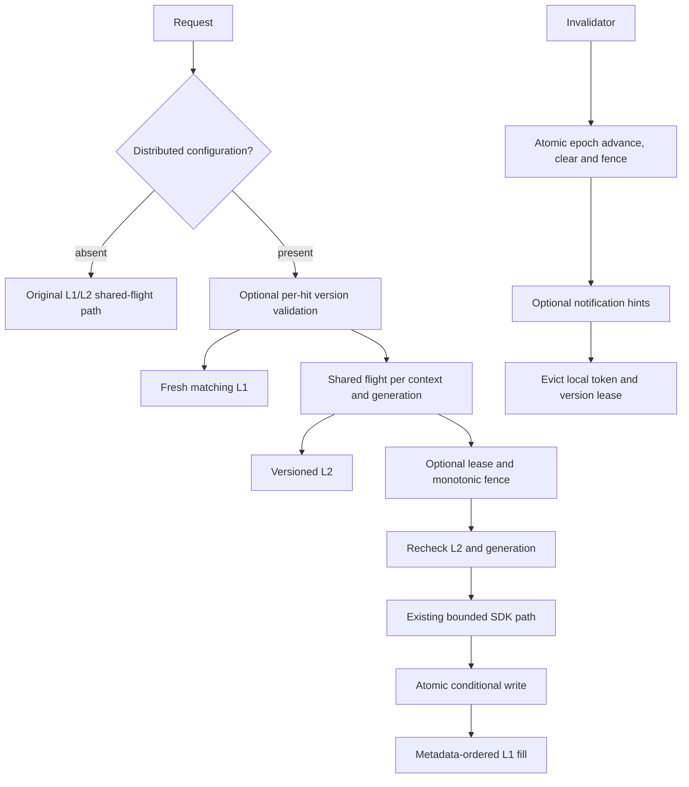

# Architecture

This is a backend library, not an ASP.NET application. Core contracts and immutable request
snapshots live in `Contracts.cs`; orchestration in `TokenService.cs`; composition in
`ServiceCollectionExtensions.cs`. All source paths below are relative to
`src/TokenAcquisitionService/`; test names refer to `tests/TokenAcquisitionService.Tests/`.

## Components



## Cache-aside and singleflight



## SDK and L2 failure

```mermaid
sequenceDiagram
    participant A as Owner
    participant L2
    participant SDK
    participant B as Waiter
    A->>L2: Read
    L2-->>A: Failure
    Note over A: Best effort logs fixed warning; strict mode throws
    A->>SDK: Acquire
    B->>A: Wait on same-key gate
    SDK-->>A: Exception
    Note over A: No cache fill; finally releases gate
    A-->>B: Gate available, recheck and retry
```

## Cross-instance race

```mermaid
sequenceDiagram
    participant A
    participant L2
    participant B
    A->>L2: Read miss
    B->>L2: Read miss
    Note over A: Older acquisition stalls
    B->>L2: Write newer
    A->>L2: Late older write
    Note over L2: Unconditional replacement; older wins
```

```text
Caller -> ITokenService -> fresh L1
                       -> per-key async gate -> recheck L1 -> fresh L2 -> promote
                                                         -> ITokenSdk -> L2 -> L1
```

Constructor-injected `ITokenSdk`, `ITokenCache`, `TimeProvider`, options, and logger isolate
the library from SDK/storage technologies. An adapter translates SDK request/result models
without changing security context. `TokenResult` retains SDK absolute expiry. `CacheEnvelope`
binds a cached result to the canonical request hash and a residence deadline.

An owned `MemoryCache` bounds L1 to 10,000 entries. Its physical expiration uses the runtime
clock; the logical envelope deadline and token validity always use `TimeProvider`, including
on every L1 read. Early physical eviction is safe. Logical expiration is the correctness
boundary and is deterministic under the test clock.

`InMemoryTokenCache` simulates shared L2 using a concurrent dictionary. It is not a production
storage engine, has no cross-process connectivity, and retains expired dictionary entries until
overwritten. A real adapter needs native TTL deletion, serialization, access control, limits,
and protected transport. Use one instance per shared simulated store, and separate `TokenService`
instances to model independent processes.

## Ownership and scope

Branch 1 retains per-key semaphores for the service lifetime. Branch 2 replaces them with
reclaimed lazy shared tasks, bounded SDK concurrency, and service-owned shutdown/deadlines.
See [production resilience](PRODUCTION_RESILIENCE.md) for the current lifetime and failure model.
SDK and cache adapters are owned by their DI container, not by the service.

The five correctness decisions have dedicated documents:
[identity](CACHE_IDENTITY.md), [expiration](EXPIRATION.md),
[concurrency](CONCURRENCY.md), [races](RACE_CONDITIONS.md),
[failures](FAILURE_BEHAVIOR.md). The implementation makes no attempt to parse JWTs or implement
OAuth, issuance, signing, or an identity provider.

## Branch 3 optional path



`Distributed/` contains narrow authority, conditional-cache, lease, and notification contracts,
the orchestration policy, and clearly marked in-memory demonstration adapters. The policy owns
only local version-lease state/subscription. `TokenService` retains its existing shared-flight,
SDK capacity, shutdown, expiration, and telemetry responsibilities. Configuration is constructor
injected, not selected through static/global state.

`TokenExpirationPolicy` centralizes freshness and deadline calculation for both paths; the
distributed extension does not duplicate or relax token validity rules. Public authority lookups
also link caller and shutdown cancellation, even before a shared fill exists.
