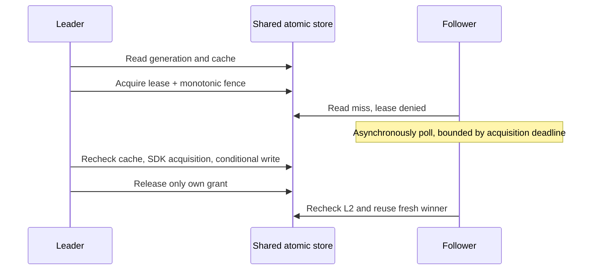

# Distributed coordination (Branch 3)

## Optional composition

The original path is unchanged when `DistributedConfiguration` is absent. No version lookup,
distributed lease, or notification dependency is then used. With configuration present:

```csharp
var store = new InMemoryDistributedStore(TimeProvider.System); // demonstration adapter
services.AddSingleton<ITokenCache>(store);
services.AddSingleton<ITokenSdk, YourSdkAdapter>();
services.AddTokenAcquisitionService(distributed: new DistributedConfiguration(
    Versions: store, Cache: store, Leases: store,
    Notifications: new InMemoryInvalidationBus(),
    Options: new DistributedOptions
    {
        EnableLeases = true,
        ValidateVersions = true,
        LocalVersionLease = TimeSpan.Zero
    }));
```

`YourSdkAdapter` is application-owned. Use real protected adapters for deployment.
`EnableLeases=false` retains conditional writes using atomically reserved fences.
`ValidateVersions=false` removes per-hit version checks; a cache fill still needs an authoritative
generation for conditional writes. Notifications and local version leases are independently optional.
Versioned writes, invalidation, and fences must share one atomic authority domain; merely registering
unrelated storage implementations behind these interfaces is not sufficient.

## Protocol and invariant



`DistributedPolicy.FillAsync` rechecks after leadership, calls the existing bounded SDK path, and
writes an envelope containing invalidation generation and fence. `InMemoryDistributedStore`
performs generation/fence/ownership/expiry checks and replacement under one **per-key** monitor;
no monitor covers SDK calls or any asynchronous I/O. Distinct keys remain independent.
The simulation's dictionary indexes states in expected O(1); per-key operations are O(1), apart
from clock/key work. Each service retains bounded L1/version-lease caches and active flights;
the shared simulation retains authority state per key.

## Expiry, failure, late writer

A owns fence 10 -> stalls -> lease expires -> B gets fence 11 -> B writes -> A writes 10:
the store rejects A. A rereads the winning envelope or causes a bounded consistency retry.
An expired lease is rejected even before a successor writes. Omitting its grant cannot bypass the
lease check. Reserving a non-lease fence explicitly revokes any outstanding lease and advances
ordering; mixed participants therefore remain write-safe but may cause extra work.

`ReleaseAsync` compares the entire grant, including random ownership and fence. An old release
cannot remove a successor's lease. Cancellation/failure enters `finally`, where release has its
own bounded authority deadline; failed release is logged and expiry allows progress.
The acquisition deadline can therefore be followed by up to one release-timeout cleanup interval.
No lease renewal is implemented; long SDK operations may overlap successor acquisitions.

## Guarantees vs non-guarantees

- One active unexpired lease grant per key in the authoritative simulation.
- Conditional writes reject revoked/expired/stale grants and stale generations.
- Healthy overlapping instances normally coalesce on one leader; followers reread L2.
- An SDK failure releases leadership, allowing another instance to recover.
- **Not** at-most-one SDK call across time: expiration, cancellation, fallback, or crashes allow
  duplicate issuance. A lease is not exactly-once effects.
- **Not** a proof about real partitions, clock differences, cache failover, or Redis transactions.
  Implement the same authority-side atomics and durable monotonic ordering in a real adapter.

## Relevant tests

`DistributedTests`: leader/follower, expired leader, failed leader, ownership-safe release,
out-of-order conditional writes, parallel fences, atomic invalidation, conditional write failure.
`InvalidationTests`: five-instance/100-caller contention, shutdown during follower coordination,
lease-free fenced writes, and delayed local generation fill. `TokenService.WriteLocal` uses fixed
short in-memory stripes to compare metadata before replacing L1, never a global acquisition lock.

Alternatives: database row transactions, Redis server-side scripts, consensus-backed leases, or
accepting duplicate issuance with idempotent SDK behavior. Stronger mechanisms increase dependency
cost, latency, outage sensitivity, and operational obligations; choose only required guarantees.
